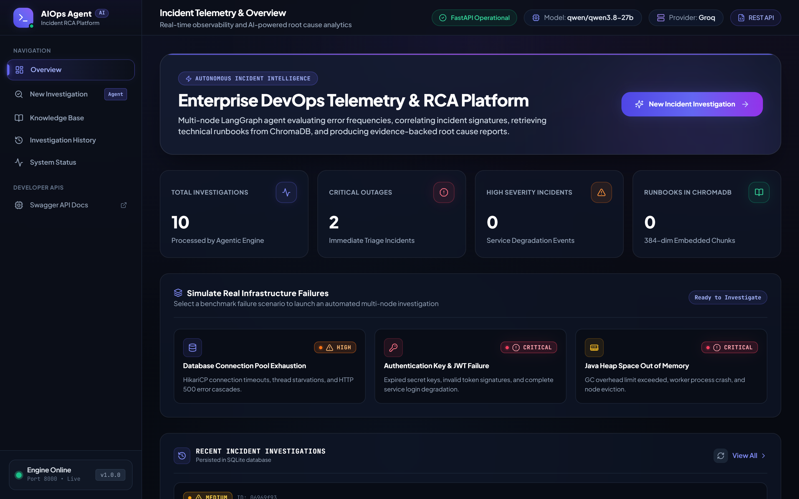
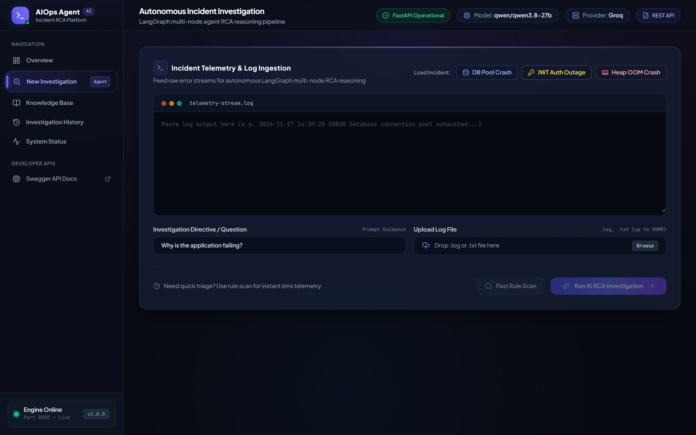
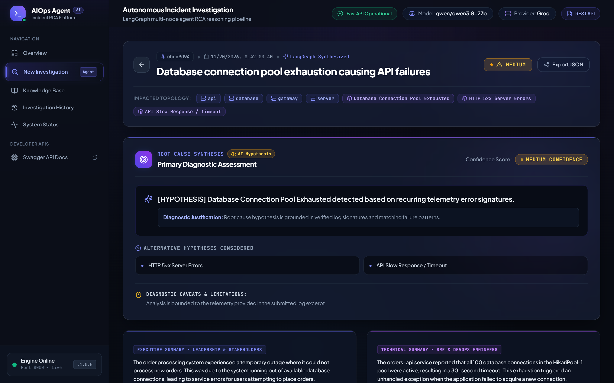
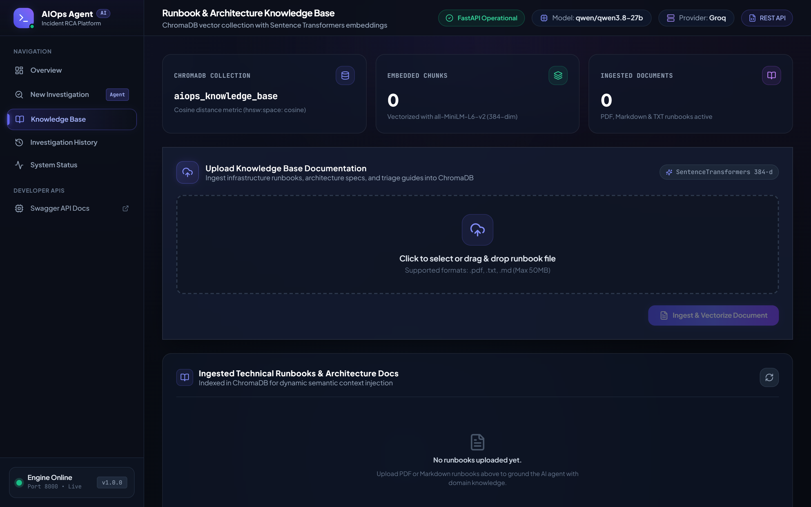
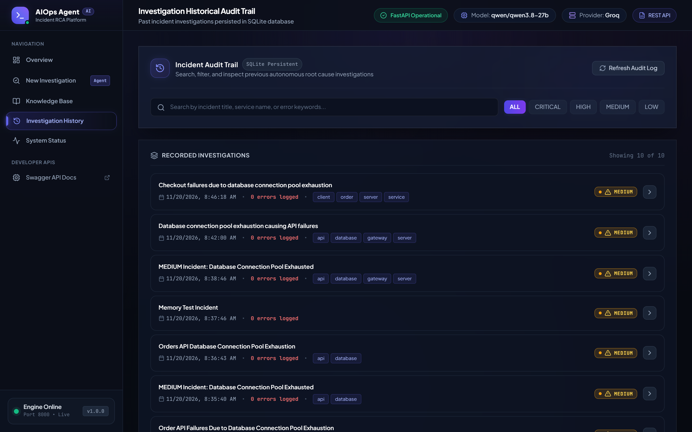
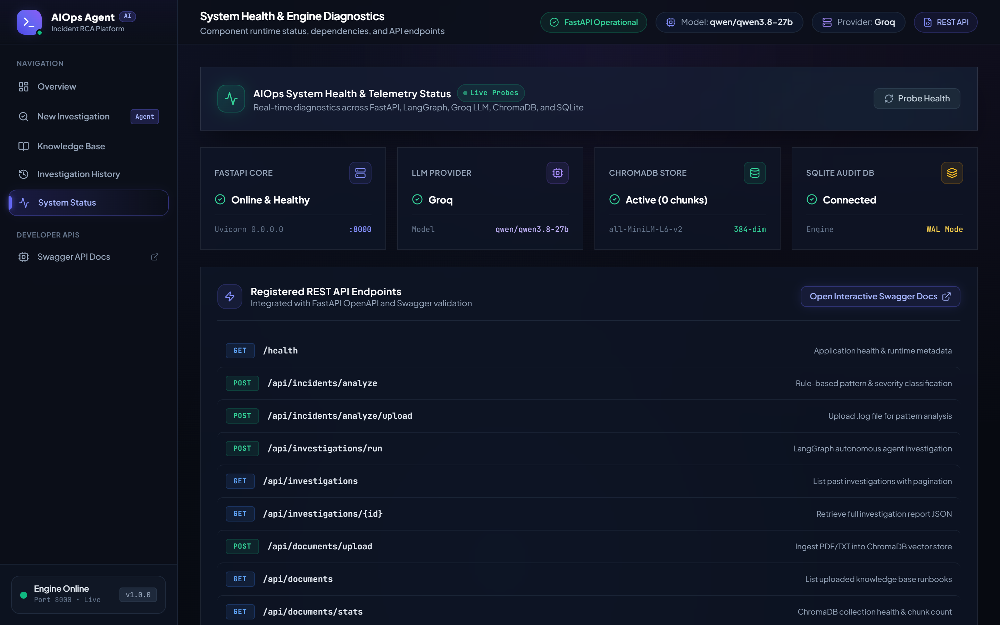
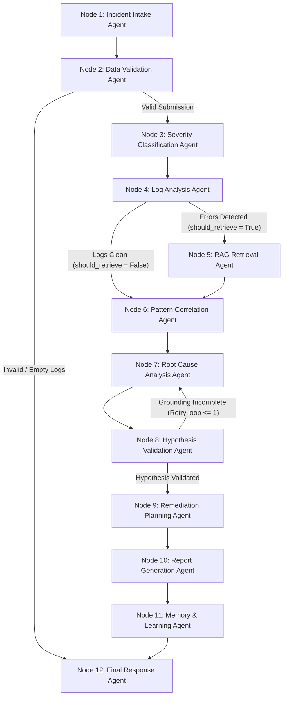

# ⚡ AIOps Agent – Agentic AI Incident Investigation & Root Cause Analysis Platform

[](file:///d:/AI_project/AIOps-Agent/backend/tests)
[](file:///d:/AI_project/AIOps-Agent/backend/app/agents)
[](file:///d:/AI_project/AIOps-Agent/evaluation)
[](file:///d:/AI_project/AIOps-Agent/evaluation)
[](https://groq.com)

> **An Agentic AI-Powered Platform for DevOps, SRE, and Cloud Reliability Teams**  
> Ingests multi-service production logs, detects system anti-patterns, executes semantic runbook retrieval (RAG), and orchestrates an autonomous **12-Node LangGraph Agent** to generate evidence-grounded Root Cause Analysis (RCA) reports with prioritized remediation plans.

---

## 📸 Platform Screenshots

### 1. Telemetry & Incident Overview Dashboard
*Real-time observability overview with high-level system metrics, active service counters, and recent incident triage.*


---

### 2. Autonomous Incident Investigation Interface
*Log ingestion console with pre-packaged failure signatures (DB Pool Exhaustion, JWT Auth Failure, JVM OOM), query input, and quick rule-based pattern scanner.*


---

### 3. Evidence-Grounded Root Cause Analysis (RCA) Report
*Full investigation view separating deterministic OBSERVED FACTS from speculative AI HYPOTHESES, citing exact log lines and offering prioritized remediation steps.*


---

### 4. Runbook & Architecture Knowledge Base
*Semantic vector search interface powered by ChromaDB and Sentence Transformers (`all-MiniLM-L6-v2`) for architectural documentation and troubleshooting guides.*


---

### 5. Historical Investigation Audit Trail
*Persistent incident record trail stored in SQLite with searchable severity filters, timestamps, and one-click detailed report reload.*


---

### 6. System Health & Engine Diagnostics
*Live component diagnostic monitoring for FastAPI backend, ChromaDB vector store, Groq LLM API, and SQLite database.*


---

## 🚀 Key Architectural Capabilities

- **🤖 12-Node Agentic StateGraph:** Upgraded from a simple chain into an orchestrated multi-agent StateGraph featuring typed state reducers, early input validation rejection, conditional RAG querying, and evidence grounding retry loops.
- **🛡️ 8 Deterministic Anti-Pattern Detectors:** Immediate sub-millisecond regex signature matching for Connection Pool Exhaustion, Memory Leaks / Java OOM, HTTP 5xx Cascading Failures, API Latency Violations, JWT/Auth Failures, Disk I/O Bottlenecks, and Network Partitions.
- **📚 Semantic RAG with ChromaDB:** Local Sentence Transformers (`all-MiniLM-L6-v2`) embeddings indexing PDF and TXT architectural runbooks with cosine similarity nearest-neighbor search.
- **🎯 Fact vs. Hypothesis Separation:** Strictly isolates verifiable facts (line numbers, timestamps, error rates) from AI-generated hypotheses, protecting engineering teams from LLM hallucinations.
- **⚡ Resilient Groq Integration:** Connects with Groq (`qwen/qwen3.8-27b`) with automatic fallback to deterministic pattern-driven RCA on rate limits or API outages.
- **💾 Full Audit Persistence:** SQLite database retaining incident metadata, telemetry traces, and diagnostic payloads.

---

## 🏗️ 12-Node Multi-Agent Architecture



### Node Responsibility Breakdown

| Node | Name | Function / Responsibility | Output State Keys |
| :---: | :--- | :--- | :--- |
| **1** | `incident_intake_node` | Accepts raw incident logs, environment, and service metadata; initializes UUID and timestamps. | `incident_id`, `incident_input`, `intake_timestamp` |
| **2** | `data_validation_node` | Validates log non-emptiness, normalizes strings, and catches malformed inputs early. | `normalized_context`, `is_valid_input`, `validation_errors` |
| **3** | `severity_classification_node` | Deterministically calculates severity (0–100 score) using error counts, cascading risk, and service tier. | `severity`, `severity_score`, `severity_reasoning` |
| **4** | `log_analysis_node` | Parses logs, computes error frequencies, and sets conditional retrieval flag `should_retrieve`. | `log_analysis`, `parsed_entries`, `should_retrieve` |
| **5** | `rag_retrieval_node` | Queries ChromaDB using Sentence Transformers embeddings for matching historical incidents and runbooks. | `retrieved_documents`, `rag_context_text` |
| **6** | `pattern_correlation_node` | Correlates logs with 8 known infrastructure anti-patterns (OOM, DB connection pool, cascading 5xx). | `correlated_patterns`, `matching_anti_patterns` |
| **7** | `root_cause_analysis_node` | Invokes Groq LLM (`qwen/qwen3.8-27b`) with automatic fallback to deterministic reasoning on rate limits. | `root_cause_hypotheses`, `primary_root_cause` |
| **8** | `hypothesis_validation_node` | Cross-references LLM hypotheses with verified log citations; assigns confidence level (HIGH/MED/LOW). | `validated_hypotheses`, `confidence_score`, `evidence_grounding` |
| **9** | `remediation_planning_node` | Synthesizes prioritized immediate mitigation steps and long-term permanent architecture recommendations. | `remediation_plan`, `immediate_actions`, `permanent_fixes` |
| **10** | `report_generation_node` | Builds comprehensive, typed Pydantic `InvestigationReport` model separating facts from AI hypotheses. | `investigation_report`, `executive_summary` |
| **11** | `memory_learning_node` | Persists completed report and full node execution audit trail into SQLite (`storage/aiops.db`). | `memory_persisted`, `memory_record_id` |
| **12** | `final_response_node` | Packages terminal API response payload, computes total execution latency, and marks workflow complete. | `final_response`, `is_complete`, `total_latency_ms` |

---

## 🛠️ Technology Stack

| Layer | Technologies |
|---|---|
| **Frontend** | React 18, Vite 6, Tailwind CSS, Lucide React, Axios |
| **Backend API** | FastAPI, Uvicorn, Pydantic v2, Structlog, AsyncIO |
| **Agentic AI** | LangGraph, LangChain Core, Groq SDK (`qwen/qwen3.8-27b`) |
| **Vector DB & RAG**| ChromaDB, Sentence Transformers (`all-MiniLM-L6-v2`), PyPDF |
| **Storage & DB** | SQLite (WAL Mode), SQLAlchemy ORM |
| **Testing & Eval** | Pytest (44 tests), Custom Benchmark Evaluation Suite |
| **DevOps** | Docker (CPU-optimized PyTorch), Docker Compose, Nginx Alpine |

---

## ⚙️ Quick Start Guide

### 1. Prerequisites
- **Python 3.11+** (Tested on Python 3.13.7)
- **Node.js 18+** (Tested on Node.js v24.12.0)
- **Groq API Key** (Free tier available at [console.groq.com](https://console.groq.com))

---

### 2. Backend Setup

```bash
# Navigate to backend directory
cd backend

# Install dependencies
pip install -r requirements.txt

# Configure environment variables
# Copy template and add your Groq API key:
cp .env.example .env
```

Ensure `backend/.env` contains your key:
```env
GROQ_API_KEY=gsk_your_groq_api_key_here
LLM_MODEL=qwen/qwen3.8-27b
LLM_MAX_TOKENS=800
PORT=8000
```

Start the FastAPI backend:
```bash
python -m uvicorn app.main:app --host 0.0.0.0 --port 8000 --reload
```
Interactive Swagger API Docs: **`http://localhost:8000/docs`**  
Health Check Endpoint: **`http://localhost:8000/health`**

---

### 3. Frontend Setup

```bash
# Navigate to frontend directory
cd frontend

# Install dependencies
npm install

# Start Vite development server
npm run dev
```
Open **`http://localhost:5173`** to access the AIOps Observability Dashboard.

---

## 🧪 Automated Testing & Benchmark Evaluation

### Run Full Pytest Suite (44 Tests)
```bash
cd backend
python -m pytest tests/ -v
```
*Executes all 14 agent node tests (`test_agent_nodes.py`), 27 core backend tests (`test_backend.py`), and 3 live Groq tests (`test_groq_live.py`).*  
**Result:** `44 passed in 118.24s (100% pass rate)`

### Run Benchmark Evaluation Suite
```bash
# From project root
python evaluation/evaluate.py
```
**Results:**
- **Severity Classification Accuracy:** `100.0%`
- **Pattern Detection F1-Score:** `91.11%`
- **Deterministic Pipeline Latency:** `7.7 ms`

---

## 🐳 Docker Deployment

The system is configured with optimized multi-stage containers and CPU-only PyTorch wheels (reducing container build sizes from 4GB to <500MB):

```bash
# Verify configuration
docker compose config

# Build and start services
docker compose up -d --build

# Inspect logs
docker compose logs -f
```

---

## 📁 Repository Structure

```
AIOps-Agent/
├── Dockerfile                                   ✅ Backend Containerfile (CPU PyTorch optimized)
├── docker-compose.yml                           ✅ Multi-service composition (Backend + Frontend)
├── .gitignore                                   ✅ Clean repository shielding rules
├── STATUS.md                                    ✅ Real-time engineering dashboard
├── README.md                                    ✅ Complete system documentation
│
├── backend/
│   ├── .env.example                             ✅ Environment template
│   ├── requirements.txt                         ✅ Locked dependencies
│   ├── Dockerfile                               ✅ Backend container build
│   │
│   ├── app/
│   │   ├── main.py                              ✅ FastAPI app entry, CORS & lifespan
│   │   ├── config.py                            ✅ Pydantic BaseSettings (llm_max_tokens=800)
│   │   │
│   │   ├── api/routes/
│   │   │   ├── health.py                        ✅ GET /health
│   │   │   ├── incidents.py                     ✅ POST /api/incidents/analyze, upload
│   │   │   ├── documents.py                     ✅ POST /api/documents/upload, stats
│   │   │   └── investigations.py                ✅ POST /api/investigations/run, list, get
│   │   │
│   │   ├── core/
│   │   │   ├── logging.py                       ✅ structlog JSON/console logging
│   │   │   └── exceptions.py                    ✅ Custom typed HTTP exceptions
│   │   │
│   │   ├── ingestion/
│   │   │   ├── log_parser.py                    ✅ Multi-format regex log parser
│   │   │   └── document_loader.py               ✅ PDF (pypdf) & TXT runbook loader
│   │   │
│   │   ├── analysis/
│   │   │   ├── frequency_analyzer.py            ✅ Error frequency & anomaly calculation
│   │   │   ├── pattern_detector.py              ✅ 8 infrastructure anti-patterns
│   │   │   └── severity_classifier.py           ✅ Weighted 0–100 scoring model
│   │   │
│   │   ├── rag/
│   │   │   ├── chunking.py                      ✅ Overlapping text chunker
│   │   │   ├── embeddings.py                    ✅ Sentence Transformers (all-MiniLM-L6-v2)
│   │   │   ├── vector_store.py                  ✅ ChromaDB cosine vector storage
│   │   │   └── retriever.py                     ✅ Semantic search & thresholding
│   │   │
│   │   ├── agents/
│   │   │   ├── state.py                         ✅ TypedDict AgentState with list reducers
│   │   │   ├── prompts.py                       ✅ Structured system prompts
│   │   │   ├── tools.py                         ✅ LangChain-compatible tools
│   │   │   ├── nodes.py                         ✅ 12 distinct agent nodes + legacy wrappers
│   │   │   └── graph.py                         ✅ 12-node StateGraph with conditional routing
│   │   │
│   │   ├── schemas/
│   │   │   ├── incident.py                      ✅ Pydantic incident validation contracts
│   │   │   └── report.py                        ✅ Pydantic InvestigationReport schema
│   │   │
│   │   ├── services/
│   │   │   ├── llm_service.py                   ✅ ChatGroq client with token caps & fallback
│   │   │   └── investigation_service.py         ✅ Graph runner & SQLite persistence
│   │   │
│   │   └── database/
│   │       └── connection.py                    ✅ SQLAlchemy engine & get_db_context()
│   │
│   └── tests/
│       ├── test_agent_nodes.py                  ✅ 14 node unit tests
│       ├── test_backend.py                      ✅ 27 backend integration tests
│       └── test_groq_live.py                    ✅ 3 live Groq LLM tests
│
├── frontend/
│   ├── package.json                             ✅ React 18, Vite, Tailwind, Lucide
│   ├── nginx.conf                               ✅ Production Nginx reverse proxy
│   ├── Dockerfile                               ✅ Multi-stage Node->Nginx build
│   │
│   └── src/
│       ├── components/                          ✅ 12 reusable dark-mode UI components
│       ├── pages/                               ✅ 5 dashboard views
│       └── services/api.js                      ✅ Centralized Axios API client
│
├── docs/
│   ├── images/                                  ✅ High-DPI platform UI screenshots
│   ├── architecture.md                          ✅ Architecture deep dive
│   ├── api_documentation.md                     ✅ Complete REST API contracts
│   └── audits/                                  ✅ Engineering audit records
│
└── evaluation/
    ├── test_cases.json                          ✅ 6 standardized benchmark scenarios
    ├── metrics.py                               ✅ Precision, Recall, F1, Accuracy scoring
    └── evaluate.py                              ✅ Automated evaluation runner
```

---

## 📄 License
This project is licensed under the MIT License.
